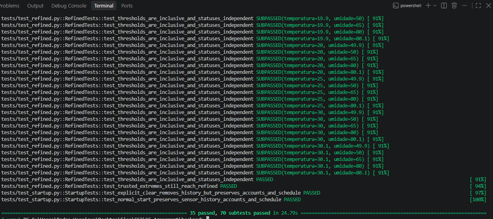
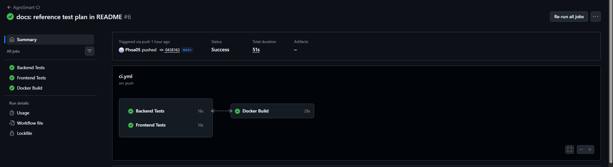

# AgroSmart — Plano de Testes e Evidências

**Projeto:** Global Solution FIAP — AgroSmart  
**Área:** DevOps, Segurança e Qualidade  
**Data da execução:** 16/11/2026  
**Status:** Testes automatizados aprovados

## 1. Objetivo

Este documento apresenta o plano de testes do AgroSmart, com o objetivo de demonstrar a qualidade, a confiabilidade e a integridade das funcionalidades desenvolvidas.

Os testes abrangem autenticação, autorização, validação de dados, persistência, integração com sensores e inteligência artificial.

A execução é realizada localmente com pytest e automaticamente por meio de uma pipeline de integração contínua (CI) utilizando GitHub Actions.

## 2. Ambiente de testes

| Tecnologia | Utilização |
|---|---|
| Python 3.12 | Execução do backend |
| FastAPI | API REST |
| pytest | Testes automatizados |
| React | Frontend |
| Docker | Containerização |
| GitHub Actions | Integração contínua |
| SQLite | Persistência de dados |

Os testes do backend estão localizados em `backend/tests/`.

A configuração da pipeline encontra-se em `.github/workflows/ci.yml`.

## 3. Matriz de casos de teste

| ID | Cenário | Resultado esperado | Situação |
|---|---|---|---|
| CT01 | Login com senha incorreta | Impedir autenticação | Aprovado |
| CT02 | Acesso a rota protegida sem autenticação | Retornar acesso não autorizado | Aprovado |
| CT03 | Logout de usuário autenticado | Revogar sessão | Aprovado |
| CT04 | Programação de irrigação com parâmetros inválidos | Rejeitar dados inválidos | Aprovado |
| CT05 | Recebimento de leituras inválidas | Não promover dados inválidos à camada refinada | Aprovado |
| CT06 | Falha na persistência de dados | Reverter operações inconsistentes | Aprovado |
| CT07 | Reinicialização do backend | Preservar histórico e configurações | Aprovado |
| CT08 | Recomendação de IA com dados insuficientes | Não chamar o provedor externo | Aprovado |
| CT09 | Inicialização com limpeza explícita | Limpar histórico e preservar contas | Aprovado |

Os cenários são cobertos pelos testes automatizados presentes nos arquivos `test_auth.py`, `test_refined.py`, `test_startup.py` e `test_ia.py`.

## 4. Execução dos testes

### 4.1 Execução local

Os testes podem ser executados no diretório `backend` com o comando:

```powershell
.\.venv\Scripts\python.exe -m pytest -v
```

**Resultado obtido em 16/11/2026:**

- 35 testes aprovados.
- 70 subtestes aprovados.
- Nenhuma falha.
- Tempo de execução: 24,94 segundos.

### 4.2 Integração contínua

A execução AgroSmart CI #6 foi concluída com sucesso
na branch `main`, commit `0438163`.

- Backend Tests: aprovado (16 s)
- Frontend Tests: aprovado (10 s)
- Docker Build: aprovado (29 s)
- Duração total: 51 segundos.

## 5. Evidências de execução

### 5.1 Evidência 01 — Testes locais

A imagem abaixo comprova a execução da suíte automatizada do backend, apresentando 35 testes e 70 subtestes aprovados.

**Arquivo:** `docs/evidencias/pytest-local.png`



### 5.2 Evidência 02 — Pipeline GitHub Actions

A imagem abaixo demonstra a execução bem-sucedida da pipeline de integração contínua, com aprovação dos jobs Backend Tests, Frontend Tests e Docker Build.

**Arquivo:** `docs/evidencias/github-actions-ci.png`



## 6. Critérios de aceite

- [x] Pelo menos cinco casos de teste documentados.
- [x] Testes automatizados implementados.
- [x] Execução local concluída sem falhas.
- [x] Pipeline de integração contínua executada com sucesso.
- [x] Build das imagens Docker validado.
- [x] Capturas de tela anexadas ao repositório.

## 7. Conclusão

O AgroSmart possui testes automatizados que verificam funcionalidades essenciais do sistema, incluindo autenticação, persistência, integridade dos dados e regras de negócio.

A integração com GitHub Actions permite validar automaticamente as alterações realizadas no repositório, contribuindo para a identificação antecipada de regressões e para a qualidade das entregas.

As evidências apresentadas demonstram a execução dos testes e a validação automatizada do projeto.